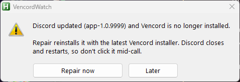

# VencordWatch

Tells you when a Discord update has quietly removed [Vencord](https://vencord.dev/), and puts it back with one click.

Vencord works by patching files inside Discord's install folder. When Discord updates itself it installs into a fresh folder, and the patch is gone. Discord keeps working, just without Vencord, so the first sign is usually that your plugins and theme have vanished and you have to dig out the installer again. VencordWatch notices within a minute or two and offers the repair.

## Behavior

- **Detection.** Every minute it checks Discord's newest version folder. If Vencord is missing there two checks in a row, an alert appears. It stays on top but doesn't steal focus, so it won't interrupt a game.
- **Repair now** downloads the latest official Vencord installer, reinstalls Vencord (which also gets you the newest Vencord build) and starts Discord again. The installer closes Discord while it works, so don't click it in the middle of a call.
- **Later** hides the alert for 2 hours. If you reinstall Vencord some other way, the alert closes by itself.
- **Your settings are safe.** Vencord keeps its plugins, settings and themes in `%APPDATA%\Vencord`, which Discord updates don't touch. After a repair everything is back as it was.
- **Tray menu:** check now, repair now, *Start with Windows*, open the log, reload, exit.

## Install

**Easiest:** download `VencordWatch.exe` from the [latest release](https://github.com/Shadetail/VencordWatch/releases/latest) and run it. Right-click its tray icon and tick **Start with Windows** so it keeps watching after a reboot.

The exe is the script below compiled with AutoHotkey's own compiler. It isn't code-signed, so Windows SmartScreen may warn about an unknown publisher the first time (*More info* → *Run anyway*), and the odd antivirus flags compiled AutoHotkey scripts on principle. If you'd rather not trust an exe, run the script instead:

**From source:** install [AutoHotkey](https://www.autohotkey.com/) v1.1 and run `VencordWatch.ahk`.

## Requirements

- Windows 10 or 11
- The Discord desktop app with Vencord installed (Stable by default; see below for PTB and Canary)
- An internet connection when repairing (it fetches the current installer from [Vencord's GitHub releases](https://github.com/Vencord/Installer/releases); the last downloaded copy is reused when offline)

## Command line

| Switch | What it does |
|---|---|
| `--root <dir>` | Watch a different Discord install, for example `--root "%LOCALAPPDATA%\DiscordPTB"` or `...\DiscordCanary`. *Start with Windows* remembers it. |
| `--poll <ms>` | Check interval, default `60000`. |
| `--demo` | Shows the alert right away so you can see what it looks like. Repair only logs what it would do. |
| `--dryrun` | Normal watching, but Repair only logs the command instead of running it. |

The log, `VencordWatch.log` next to the script or exe, records when the patch went missing or came back and the installer's output from each repair.

## How it works

Discord keeps each version in its own `app-<version>` folder under `%LOCALAPPDATA%\Discord`. The Vencord installer patches the newest one by renaming `resources\app.asar` to `_app.asar` and putting a tiny loader in its place. An update creates a new `app-<version>` folder with a stock `app.asar` and no `_app.asar`, which is exactly what VencordWatch checks for. Waiting for two checks in a row skips the moment in the middle of an update when the new folder is still being written.

Repair runs the official [`VencordInstallerCli.exe`](https://github.com/Vencord/Installer) with `-install -location <Discord folder>`, cached in `%LOCALAPPDATA%\VencordWatch`. Afterwards it checks the folder again rather than trusting the installer's exit code, and only reports success if the patch is really there.

## Limitations

- One Discord install per running copy. Run a second copy with `--root` if you use Stable and PTB side by side.
- If you uninstall Vencord on purpose, VencordWatch will keep offering to put it back. Exit it, or untick *Start with Windows*.
- Not affiliated with Vencord or Discord. It just runs Vencord's own installer for you.

## License

[MIT](LICENSE)
